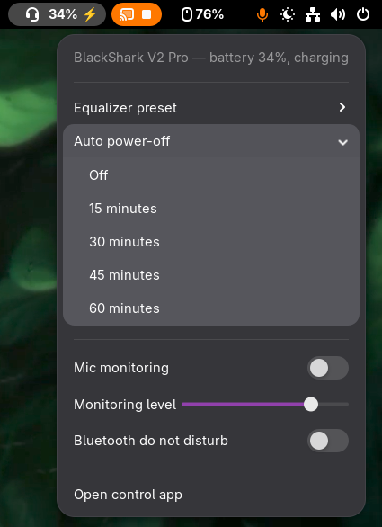

# BlackShark V2 Pro — GNOME Shell extension

A GNOME top-bar indicator for the **Razer BlackShark V2 Pro 2.4** wireless headset
(USB `1532:0555`), talking to the OpenRazer daemon over D-Bus.

<p align="center"></p>

## Features

- **Battery in the top bar** — headset icon + percentage, ⚡ while charging; refreshes every 30 s.
  The indicator hides automatically while the headset is off/unplugged and reappears on its own.
- **Quick settings in the menu**:
  - Equalizer preset (Game / Music / Movie / Game EQ 1–5 / Custom — all stored in the headset;
    the active one is check-marked and follows changes made elsewhere, e.g. the headset's button)
  - Auto power-off (Off / 15 / 30 / 45 / 60 minutes)
  - Mic monitoring (sidetone) switch + level slider
  - Bluetooth "Do Not Disturb" switch
- **"Open control app"** menu entry when the [BlackShark GUI](../blacksharkv2pro_gui) is installed
  (for the full equalizer with band sliders).

## Requirements

| Dependency | Notes |
|---|---|
| GNOME Shell **45 or newer** | Uses the ES-module extension format. |
| **OpenRazer** — BlackShark V2 Pro full-hardware-support branch | The stock OpenRazer release does **not** support this headset yet. Install driver, daemon and Python library from the feature branch (`add-blackshark-v2-pro-2.4`); the `openrazer-daemon` user service must be running and your user in the `plugdev` group. |

The extension itself has no other dependencies — it talks D-Bus directly (`org.razer`).

## Install

```sh
./install.sh
```

Installs per-user (no root) to `~/.local/share/gnome-shell/extensions/` and enables the
extension. **A freshly installed extension is only picked up when the shell restarts** — on
Wayland that means logging out and back in once; the script tells you if that is needed.

## Uninstall

```sh
./uninstall.sh
```

Disables and removes the extension. Disabling takes effect immediately (no logout);
`gnome-extensions disable blackshark@blacksharkv2pro.dev` alone hides it too if you just want it
off for a while.

## Development / live preview

```sh
./dev.sh
```

Opens a **nested GNOME Shell** (mutter development kit) in a window with the extension running —
no relogin required. Edit `extension.js`, close the window, run `./dev.sh` again. The script also
starts a private OpenRazer daemon (own run dir, so it can't clash with the real session's daemon),
so the indicator works against the real headset. On Fedora the devkit binary comes from
`mutter-devel` (`sudo dnf install mutter-devel`). Logs: run from a terminal and watch its output.

**Loading the extension into the running session without a relogin** (one-time; GNOME can hot-load
a *new* extension, it just cannot reload *changed* code): press `Alt+F2`, run `lg`, and paste into
the Evaluator:

```js
const Main = await import('resource:///org/gnome/shell/ui/main.js'); const Gio = (await import('gi://Gio')).default; const GLib = (await import('gi://GLib')).default; const u = 'blackshark@blacksharkv2pro.dev'; const e = Main.extensionManager.createExtensionObject(u, Gio.File.new_for_path(GLib.get_home_dir() + '/.local/share/gnome-shell/extensions/' + u), 2); await Main.extensionManager.loadExtension(e);
```

For *code changes* the real session always needs one relogin (ES modules cannot be reloaded —
a GNOME platform limitation); iterate in the nested shell instead and relogin once at the end.

## Troubleshooting

- **No indicator in the top bar** — the indicator is hidden while no headset is found. Check that
  the dongle is plugged in and the headset is on, and that the daemon answers:
  `gdbus call --session --dest org.razer --object-path /org/razer --method razer.devices.getDevices`
  Also make sure you logged out/in once after installing.
- **Indicator gone after updating the OpenRazer driver** — the daemon restart drops the device
  briefly; the extension re-finds it within 30 s. If the daemon itself was restarted, the same
  applies. Worst case: replug the dongle.
- **Settings and Synapse/GUI disagree** — the menu reads the live device state every time it
  opens; whatever wrote last wins. The equalizer check-mark follows the headset's EQ button too.
- **Extension shows errors after a GNOME upgrade** — check `journalctl --user -b | grep -i
  blackshark` and that your shell version is listed in `metadata.json` (`shell-version`).

## License

GPL-2.0-or-later (see `LICENSE`) — the license GNOME Shell itself uses, and the one
extensions.gnome.org expects for published extensions.
